# Manual do usuário — Fênix | Simulado de Atendimento (v1.0)

Este manual explica, passo a passo, cada tela, botão e campo do app. O Simulado de Atendimento treina atendentes de call center com uma chamada simulada por voz, em 8 passos fixos, com avaliação automática.

> Aviso: o app é um simulador de treinamento. Cenários, falas, clientes e dados são fictícios e não representam nenhuma empresa real.

## 1. Primeiro acesso (cadastro)

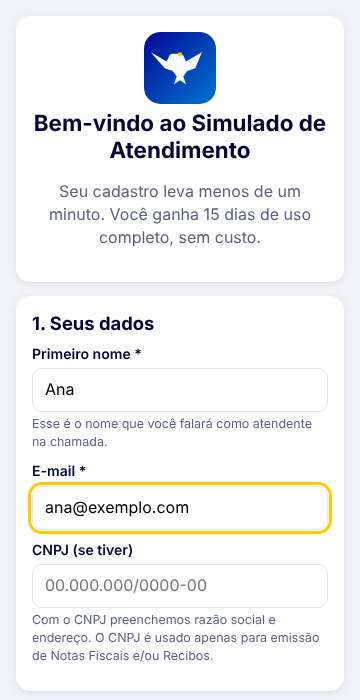

| Campo | Para que serve | Exemplo |
|---|---|---|
| Primeiro nome * | É o nome que você fala como atendente na chamada | Ana |
| E-mail * | Usado para entrar no app | ana@exemplo.com |
| CNPJ (se tiver) | Preenche razão social e endereço pela BrasilAPI. O CNPJ é usado apenas para emissão de Notas Fiscais e/ou Recibos | 00.000.000/0000-00 |
| Nick * | Seu apelido no ranking. Você pode usar o próprio nome, mas recomendamos um nick | Ana77 |
| Empresa do treino | Nome falado na abertura ("Atendimento ..."). Em branco, vale "Fênix" | Fênix |

Escolha também onde guardar os dados: **só neste aparelho (padrão)** ou **na nuvem**. Guardar só no aparelho traz o risco de perder tudo se você limpar os dados do navegador, desinstalar o app ou formatar o aparelho. Marque o aceite dos Termos de Uso e da Política de Privacidade e toque em **Começar a treinar**.

Você ganha **15 dias de uso completo**. Depois, sem licença, o app fica só para visualização (não cria roteiros nem simulações).

### Trocando o nome da empresa

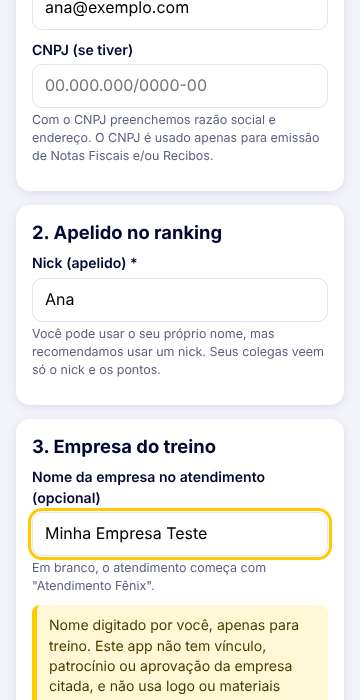

Se você digitar outro nome, aparece um aviso fixo (não dá para dispensar): o nome é só para treino, sem vínculo com a empresa citada, e o uso é de sua responsabilidade.

## 2. Início

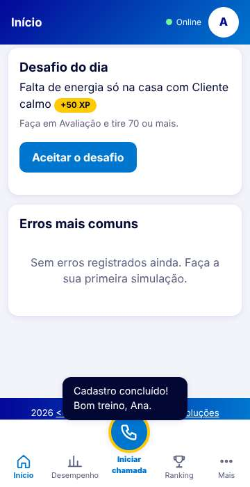

- **Iniciar chamada**: abre a preparação da simulação.
- **Indicadores** (Simulações, Avaliações, Nota média, Aprovadas, Abaixo de 70, Dias seguidos, Conquistas): toque em qualquer um para abrir a lista já filtrada.
- **Desafio do dia**: cenário e persona sorteados; faça em Avaliação com nota 70 ou mais e ganhe +50 XP.
- **Erros mais comuns**: seus 3 erros mais frequentes, com a dica para corrigir.

No celular, a barra de abas fica embaixo, com **Iniciar chamada** no botão redondo do meio. No computador, o menu fica na lateral.

## 3. Preparando a chamada

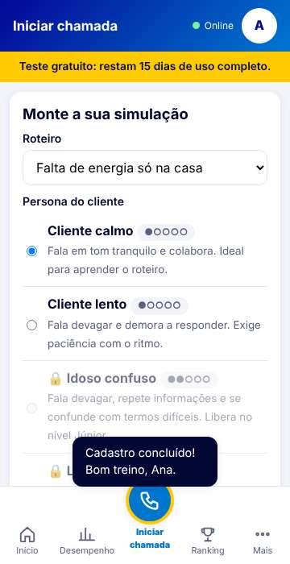

| Campo | O que faz |
|---|---|
| Roteiro | Escolhe o cenário (falta de energia, conta alta, religação etc.). Cenários difíceis liberam por nível |
| Persona do cliente | Define o jeito do cliente: calmo, lento, idoso confuso, leigo, apressado, chato, nervoso, irritado, deficiente auditivo ou empresarial |
| Modo | **Treino guiado** mostra a fala-modelo; **Treino sem ajuda** não mostra; **Avaliação** vale pontos e XP |
| Modo dica | Na Avaliação, libera o botão Dica. Cada dica usada tira 3 pontos |
| Gravar para revisão | Grava o áudio só neste aparelho |

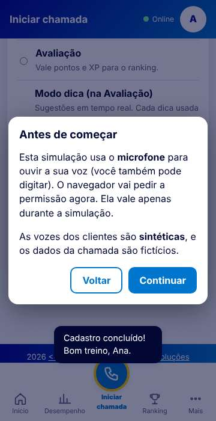

Antes da chamada, o app explica o uso do microfone. O navegador pede a permissão só durante a simulação. Se o seu navegador não reconhece voz, digite a sua fala.

## 4. Durante a chamada

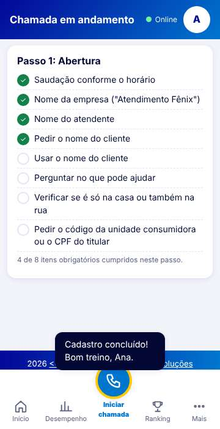

- **Cronômetro do passo**: zera a cada passo e mostra a meta. Fica verde dentro da meta, amarelo até 25% acima e vermelho depois.
- **Tempo total (TMA)**: corre até a despedida.
- **Espera nas pausas (TME)**: soma o tempo das pausas.
- **Fala e voz**: toque no microfone para falar, ou digite e toque em **Enviar**. O cliente responde com voz sintética.
- **Checklist do passo**: mostra os itens cumpridos em tempo real. No Treino guiado aparecem todos os itens e a fala-modelo.
- **Dica**: sugere o próximo item (só na Avaliação com Modo dica ligado).
- **Avançar passo**: segue mesmo com itens faltando (eles contam como não cumpridos).
- **Encerrar chamada**: finaliza e avalia o que foi feito.
- **Sair da tela** durante a chamada sempre pede confirmação.

### Os 8 passos

1. **Abertura**: saudação pelo horário, nome da empresa e do atendente, pedir o nome, "no que posso ajudar?", problema só na casa ou também na rua, código da unidade consumidora ou CPF do titular.
2. **Gestão de pausa (20 s) e confirmação positiva**: peça licença, avise que o sistema ficará mudo, aguarde a contagem, agradeça a espera, diga que localizou os dados e confirme rua, número, bairro e município.
3. **Entrevista e testes**: proponha os testes, oriente a verificação (o cliente leva cerca de 10 s) e faça as perguntas de esclarecimento.
4. **Protocolo e previsão**: peça ponto de referência e telefone de contato (e um segundo, se houver) e avise a nova pausa.
5. **Gestão de pausa (10 s)**: o protocolo é gerado e aparece na tela. Peça que o cliente anote (cerca de 5 s), informe o protocolo dígito por dígito e a previsão do técnico, e confirme com o cliente.
6. **Algo mais?**: pergunte se o cliente deseja algo mais.
7. **Direcionamento da pesquisa**: avise do redirecionamento, peça a nota com educação e informe a pesquisa por e-mail em até 48 h.
8. **Despedida**: agradeça e use a saudação final adequada ao horário.

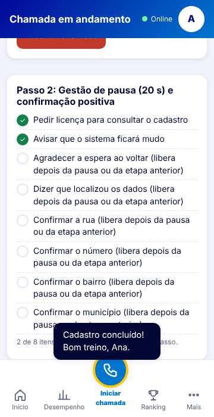

Na pausa, o cliente fica em silêncio e o cronômetro vira contagem regressiva. O botão **Chamar o cliente** encerra a pausa antes da hora.

### Comportamento do cliente

O cliente pode desviar do roteiro (dúvida, reclamação, pressa), pedir para repetir, não entender um termo técnico ou ameaçar cancelar. Reconheça o que ele sente ("Entendo", "Sinto muito") e volte ao passo. Falar por cima do cliente conta como interrupção.

## 5. Relatório da simulação

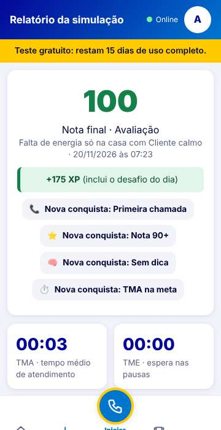

Mostra a nota (0 a 100), o XP ganho, as conquistas novas, as métricas e a pontuação por etapa:

| Etapa | Pontos (padrão) |
|---|---|
| Abertura | 15 |
| Confirmação e identificação | 15 |
| Entrevista e testes | 25 |
| Protocolo e previsão | 20 |
| Pausas bem conduzidas | 10 |
| Pesquisa e despedida | 10 |
| Tempo dentro das metas | 5 |

**Métricas:** TMA (tempo médio de atendimento), TME (espera nas pausas), FCR (resolvido no primeiro contato, simulado pelo cumprimento do roteiro), NPS simulado (nota do cliente) e qualidade da escuta ativa (confirmações, uso do nome e resposta às dúvidas do cliente).

Ainda traz tempos por passo, erros comuns com dicas, pontos fortes e fracos, recomendação do próximo treino, checklist completo e linha do tempo. Use **Baixar PDF** para guardar o relatório e **Repetir o cenário** para treinar de novo.

## 6. Desempenho, ranking e níveis

- **Desempenho**: gráfico da evolução das notas e lista de simulações com filtros (todas, avaliações, treinos, aprovadas, abaixo de 70, por persona ou por erro).
- **Ranking**: semanal, mensal e geral, mostrando só nick e pontos. Com os dados só no aparelho, mostra apenas você.
- **Níveis**: Iniciante, Júnior, Pleno, Sênior e Especialista (0 / 500 / 1.500 / 3.500 / 7.000 XP, editáveis). Só a Avaliação gera XP.
- **Conquistas**: primeira chamada, nota 90+, sem dica, TMA na meta, vencer persona difícil, 7 dias seguidos, todos os cenários e outras.

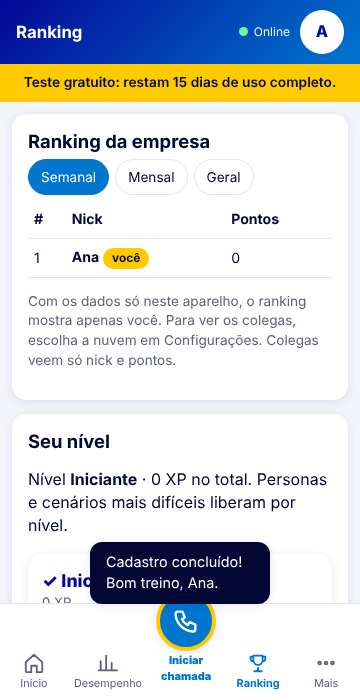

## 7. Roteiros

Todo roteiro mantém os 8 passos. Em **Roteiros** você joga os cenários de fábrica, duplica e edita (conteúdo do cenário, nome, meta e fala-modelo de cada passo) ou cria o seu. Supervisores e administradores podem marcar roteiros como oficiais. Apagar um roteiro exige digitar **APAGAR**.

## 8. Gravações

Em **Gravações** você ouve, exporta e apaga os áudios. O áudio fica somente no aparelho e nunca vai para a nuvem. Apagar exige digitar **APAGAR**.

## 9. Configurações

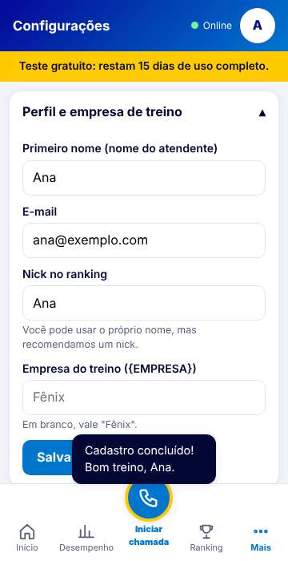

- **Perfil e empresa de treino**: nome, e-mail, nick e empresa do treino (com o aviso fixo).
- **Dados e armazenamento**: aparelho ou nuvem, com o aviso do risco de perda.
- **Preferências**: som de fundo, toque, animações, tema escuro e microfone automático.
- **Pontuação, metas e níveis**: pesos (somam 100), metas por passo e limites de XP.
- **Perfil de uso (demonstração)**: aluno, supervisor ou administrador.
- **Backup**: exportar e importar um arquivo com o histórico, os roteiros e as configurações (sem áudios).
- **Excluir dados**: apagar gravações ou **excluir minha conta e meus dados** (exige digitar APAGAR).

## 10. Supervisor e administrador

O **supervisor** observa a sessão ao vivo sem intervir (passo atual, cronômetros e checklist), revisa simulações antigas e comenta. Enquanto observa, o aluno vê a faixa fixa **"Supervisor observando"**. O **administrador** gerencia membros e perfis, cenários oficiais e a campanha "Compartilhe e ganhe".

## 11. Sobre, ajuda e compartilhar

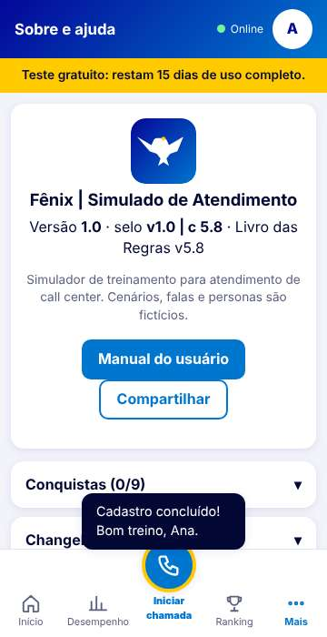

A tela **Sobre** traz a versão, o selo `v1.0 | c 5.8`, as conquistas, o Changelog (data de criação e de modificação), as políticas e o contato. O botão **Compartilhar** envia o app por WhatsApp ou e-mail.

## 12. Perguntas frequentes

- **O app abre sem internet?** Sim. Ele tenta reconectar a cada cerca de 5 minutos. PDF e consulta de CNPJ precisam de internet.
- **O microfone não funciona.** Verifique a permissão do navegador ou digite a sua fala.
- **Perdi meus dados.** Se guardava só no aparelho, restaure o último backup em Configurações.
- **O teste acabou.** Sem licença, só dá para visualizar o histórico.

*Fênix Soluções Tecnológicas — WhatsApp (79) 9 9968-0880 — Instagram @fenixsolucoestecnologicas*
