# Manual do usuário — Fênix | Simulado de Atendimento (v1.7)

Este manual explica, passo a passo, cada tela, botão e campo do app. O Simulado de Atendimento treina atendentes de call center com uma chamada simulada por voz, em 8 passos fixos, com avaliação automática. Vêm de fábrica **130 roteiros** (10 cenários × 13 personas).

> Aviso: o app é um simulador de treinamento. Cenários, falas, clientes e dados são fictícios e não representam nenhuma empresa real.

## 1. Primeiro acesso: criar conta e primeiros passos

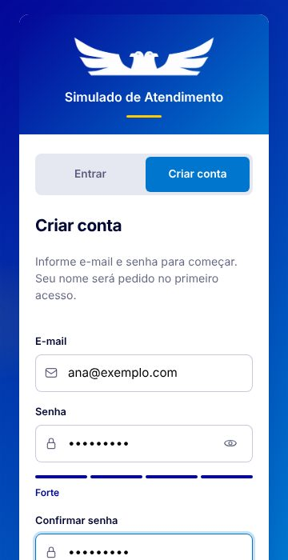

A tela de acesso segue o padrão Fênix (versão 6.1 dos modelos de login, primeiros passos e abertura). Ela tem três modos:

- **Criar conta**: informe e-mail e senha (mínimo de 8 caracteres, com indicador de força), repita a senha e aceite os Termos de Uso e a Política de Privacidade. Seu nome será pedido na etapa seguinte.
- **Entrar**: e-mail e senha. O botão do olho mostra ou esconde a senha. O botão do Google só aparece com a licença definitiva.
- **Esqueceu a senha?**: com o Fênix Core conectado, o app envia o link de redefinição por e-mail. Sem ele, o cadastro é local ao aparelho e o app deixa você definir a nova senha ali mesmo, depois de confirmar o e-mail do cadastro.

A chave **Som de abertura** liga e desliga o toque de abertura. A senha fica guardada só no aparelho, em forma embaralhada (hash), nunca em texto.

Quem já tinha cadastro nas versões anteriores entra com o e-mail e, na primeira vez, a senha digitada passa a valer.

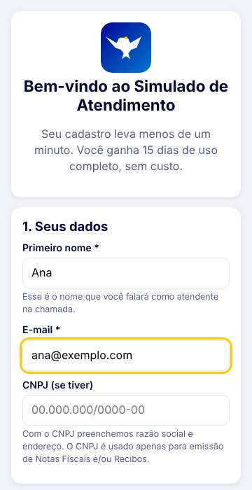

Depois de criar a conta, a tela **Vamos começar** pede os dados abaixo.

| Campo | Para que serve | Exemplo |
|---|---|---|
| Primeiro nome | É o nome que você fala como atendente na chamada | Ana |
| E-mail | Vem da conta que você acabou de criar (não editável) | ana@exemplo.com |
| CNPJ (se tiver) | Preenche razão social, nome fantasia e endereço pela consulta pública; tudo pode ser ajustado. O CNPJ é usado apenas para emissão de Notas Fiscais e/ou Recibos | 00.000.000/0000-00 |
| Apelido no ranking (nick) | Seu apelido no ranking. Você pode usar o próprio nome, mas recomendamos um nick | Ana77 |
| Empresa do treino | Nome falado na abertura ("Atendimento ..."). Em branco, vale "Fênix" | Fênix |

Escolha também onde guardar os dados: **só neste aparelho (padrão)** ou **na nuvem**. Guardar só no aparelho traz o risco de perder tudo se você limpar os dados do navegador, desinstalar o app ou formatar o aparelho. Ao tocar em **Continuar**, você concorda com os Termos de Uso e a Política de Privacidade (os links estão na própria tela).

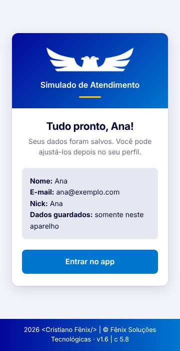

A tela **Tudo pronto** mostra o resumo e o botão **Entrar no app**. Você ganha **15 dias de uso completo**. Depois, sem licença, o app fica só para visualização (não cria roteiros nem simulações).

### Trocando o nome da empresa

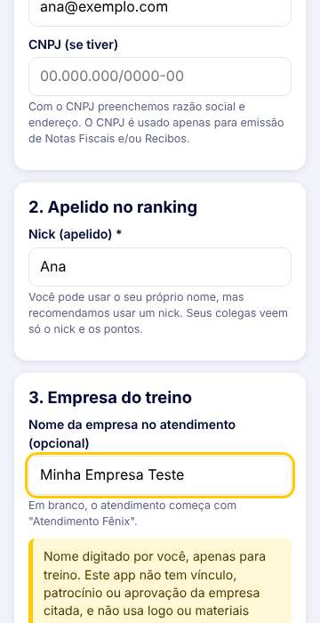

Se você digitar outro nome, aparece um aviso fixo (não dá para dispensar): o nome é só para treino, sem vínculo com a empresa citada, e o uso é de sua responsabilidade.

## 2. Início

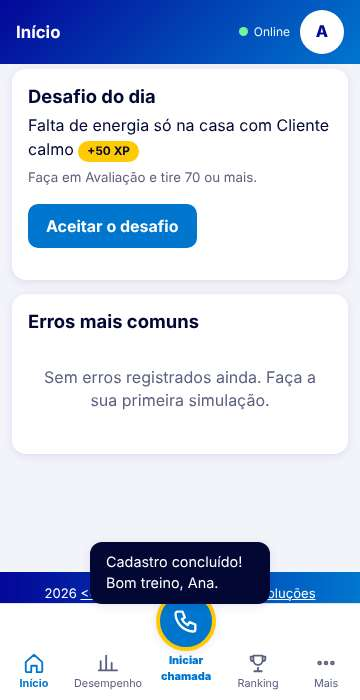

- **Iniciar chamada**: abre a preparação da simulação.
- **Indicadores** (Simulações, Avaliações, Nota média, Aprovadas, Abaixo de 70, Dias seguidos, Conquistas): toque em qualquer um para abrir a lista já filtrada.
- **Desafio do dia**: cenário e persona sorteados; faça em Avaliação com nota 70 ou mais e ganhe +50 XP.
- **Erros mais comuns**: seus 3 erros mais frequentes, com a dica para corrigir.

No celular, a barra de abas fica embaixo, com **Iniciar chamada** no botão redondo do meio. No computador, o menu fica na lateral.

## 3. Preparando a chamada

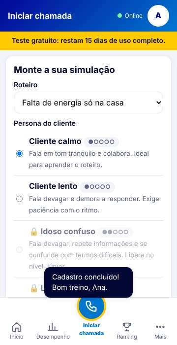

| Campo | O que faz |
|---|---|
| Roteiro | Escolhe o cenário (10 de fábrica, como falta de energia, conta alta, religação, oscilação com aparelho danificado e aviso de corte com fatura paga) ou um roteiro seu |
| Persona do cliente | Define o jeito do cliente: calmo, lento, idoso confuso, leigo, apressado, chato, nervoso, irritado, deficiente auditivo, empresarial, prolixo, exigente (pede supervisor) ou cliente vital (home care, dependente de energia) |
| Modo | **Treino guiado** mostra a fala-modelo; **Treino sem ajuda** não mostra; **Avaliação** vale pontos e XP |
| Modo dica | Na Avaliação, libera o botão Dica. Cada dica usada tira 3 pontos |
| Gravar para revisão | Grava o áudio só neste aparelho |

Ao escolher o cenário e a persona, aparece o **roteiro da combinação** (por exemplo, 01.02): o nome do cliente fictício, o objetivo do cenário, o cuidado principal, o perfil do cliente e a técnica-chave. A liberação é **por combinação**: cada roteiro libera num nível (Iniciante, Júnior, Pleno, Sênior ou Especialista). Se a combinação estiver bloqueada, o aviso diz em qual nível ela abre.

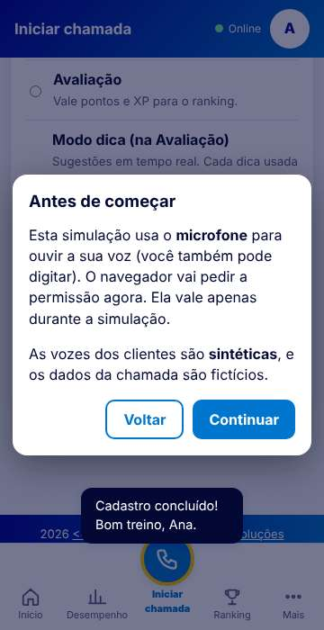

Antes da chamada, o app explica o uso do microfone. O navegador pede a permissão só durante a simulação. Se o seu navegador não reconhece voz, digite a sua fala.

## 4. Durante a chamada

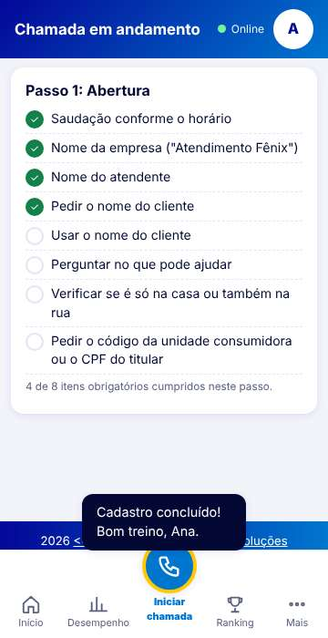

- **Cronômetro do passo**: zera a cada passo e mostra a meta do roteiro (no passo 2 a meta é 65 s: 20 s de pausa + 45 s de confirmação). Fica verde dentro da meta, amarelo até 25% acima e vermelho depois.
- **Tempo total (TMA)**: corre até a despedida.
- **Espera nas pausas (TME)**: soma o tempo das pausas.
- **Fala e voz**: toque no microfone para falar, ou digite e toque em **Enviar**. O cliente responde com voz sintética.
- **Checklist do passo**: mostra os itens cumpridos em tempo real. No Treino guiado aparecem todos os itens e o **roteiro do passo**, com as falas do atendente (A.) e as respostas do cliente (C.).
- **Itens do checklist** seguem o roteiro da combinação: se o roteiro não pede um item (por exemplo, ponto de referência), ele não é cobrado.
- **Dica**: sugere o próximo item (só na Avaliação com Modo dica ligado).
- **Avançar passo**: segue mesmo com itens faltando (eles contam como não cumpridos).
- **Encerrar chamada**: finaliza e avalia o que foi feito.
- **Sair da tela** durante a chamada sempre pede confirmação.

### Os 8 passos

1. **Abertura**: saudação pelo horário, nome da empresa e do atendente, pedir o nome, "no que posso ajudar?", problema só na casa ou também na rua, código da unidade consumidora ou CPF do titular.
2. **Gestão de pausa (20 s) e confirmação positiva**: peça licença, avise que o sistema ficará mudo, aguarde a contagem, agradeça a espera, diga que localizou os dados e confirme rua, número, bairro e município.
3. **Entrevista e testes**: proponha os testes, oriente a verificação (o cliente leva cerca de 10 s) e faça as perguntas de esclarecimento.
4. **Protocolo e previsão**: peça ponto de referência e telefone de contato (e um segundo, se houver) e avise a nova pausa.
5. **Gestão de pausa (10 s)**: o protocolo é gerado e aparece na tela. Peça que o cliente anote (cerca de 5 s), informe o protocolo dígito por dígito e a previsão do técnico, e confirme com o cliente.
6. **Algo mais?**: pergunte se o cliente deseja algo mais.
7. **Direcionamento da pesquisa**: avise do redirecionamento, peça a nota com educação e informe a pesquisa por e-mail em até 48 h.
8. **Despedida**: agradeça e use a saudação final adequada ao horário.

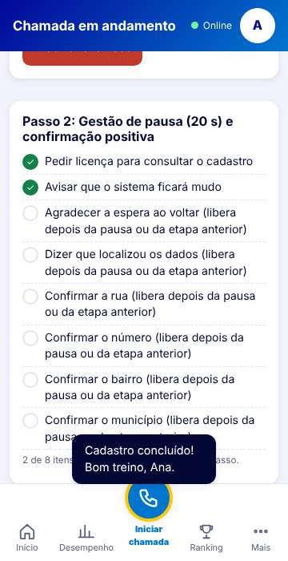

Na pausa, o cliente fica em silêncio e o cronômetro vira contagem regressiva. O botão **Chamar o cliente** encerra a pausa antes da hora.

### Comportamento do cliente

O cliente pode desviar do roteiro (dúvida, reclamação, pressa), pedir para repetir, não entender um termo técnico ou ameaçar cancelar. Reconheça o que ele sente ("Entendo", "Sinto muito") e volte ao passo. Falar por cima do cliente conta como interrupção.

## 5. Relatório da simulação

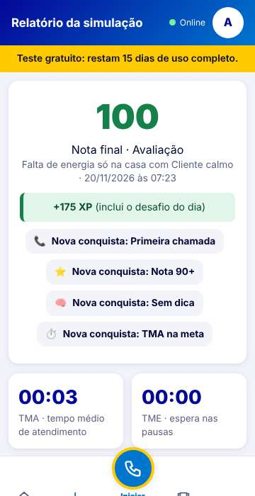

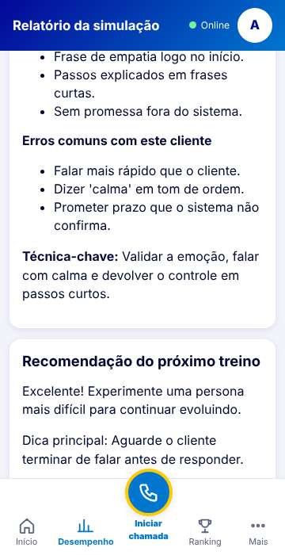

Mostra a nota (0 a 100), o XP ganho, as conquistas novas, as métricas e a pontuação por etapa:

| Etapa | Pontos (padrão) |
|---|---|
| Abertura | 15 |
| Confirmação e identificação | 15 |
| Entrevista e testes | 25 |
| Protocolo e previsão | 20 |
| Pausas bem conduzidas | 10 |
| Pesquisa e despedida | 10 |
| Tempo dentro das metas | 5 |

**Métricas:** TMA (tempo médio de atendimento), TME (espera nas pausas), FCR (resolvido no primeiro contato, simulado pelo cumprimento do roteiro), NPS simulado (nota do cliente) e qualidade da escuta ativa (confirmações, uso do nome e resposta às dúvidas do cliente).

Traz ainda **o que o avaliador observa e os erros comuns** da persona do roteiro, tempos por passo, erros comuns com dicas, pontos fortes e fracos, recomendação do próximo treino, checklist completo e linha do tempo. Use **Baixar PDF** para guardar o relatório e **Repetir o cenário** para treinar de novo.

## 6. Desempenho, ranking e níveis

- **Desempenho**: gráfico da evolução das notas e lista de simulações com filtros (todas, avaliações, treinos, aprovadas, abaixo de 70, por persona ou por erro).
- **Ranking**: semanal, mensal e geral, mostrando só nick e pontos. Com os dados só no aparelho, mostra apenas você.
- **Níveis**: Iniciante, Júnior, Pleno, Sênior e Especialista (0 / 500 / 1.500 / 3.500 / 7.000 XP, editáveis). Só a Avaliação gera XP.
- **Conquistas**: primeira chamada, nota 90+, sem dica, TMA na meta, vencer persona difícil, 7 dias seguidos, todos os cenários e outras.

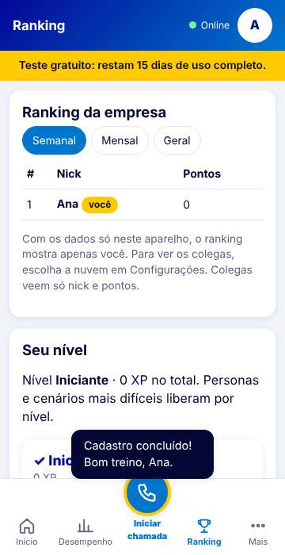

## 7. Roteiros

Todo roteiro mantém os 8 passos. Os dados (nomes, endereços, telefones, protocolos, valores e prazos) são fictícios, e a abertura é sempre "Atendimento {EMPRESA}", com o padrão **Fênix**. Ajuste prazos e valores à política da sua operação antes de usar com alunos reais.

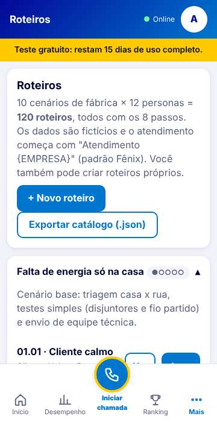

Em **Roteiros**, toque num cenário para ver as 13 personas. Em cada uma:

- **Ver**: abre o roteiro completo, com perfil do cliente, erros comuns, o que o avaliador observa e as falas de cada passo.
- **Jogar**: abre a preparação da chamada já com o cenário e a persona escolhidos.
- **Duplicar este cenário e editar**: cria um roteiro seu a partir do cenário (conteúdo do cenário, nome, meta e fala-modelo de cada passo).
- **Exportar catálogo (.json)**: baixa a lista dos 130 roteiros.

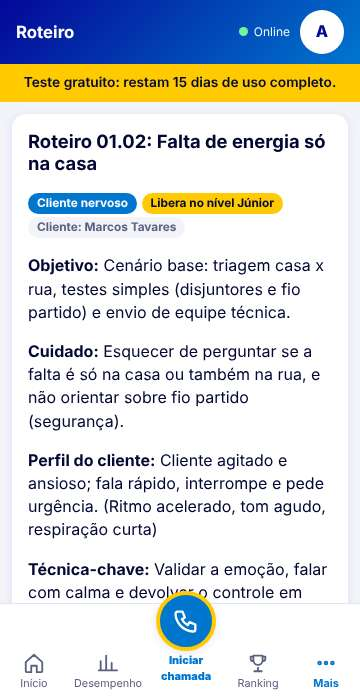

No roteiro aberto, **Baixar PDF** gera o roteiro em A4 (perfil do cliente, erros comuns, o que o avaliador observa e as falas dos 8 passos, com cabeçalho e rodapé Fênix), **Baixar .md** salva o roteiro em texto, e **Jogar este roteiro** inicia a simulação. Roteiros próprios ou oficiais aparecem nas listas "Meus roteiros" e "Roteiros oficiais". Supervisores e administradores podem marcar roteiros como oficiais. Apagar um roteiro seu exige digitar **APAGAR**.

### Persona 13: cliente vital (home care)

A persona **Cliente vital** é a familiar de um paciente em home care que usa um equipamento ligado à energia, como um concentrador de oxigênio. Qualquer falha é urgência: ela colabora com tudo, mas exige prioridade e certeza do que vai acontecer. Está nos 10 cenários e libera a partir do nível Pleno.

O que a avaliação cobra nesta persona, além do checklist de sempre:

- **Identificar a dependência de energia logo no início** e dizer ao cliente que a ocorrência será tratada como **prioritária**. Sem isso, o relatório aponta o erro "Não tratou como prioridade".
- **Levantar a autonomia** da bateria ou da reserva e **obter dois contatos**.
- **Orientar o plano de contingência**: se houver risco ao paciente ou a reserva acabar, ligar imediatamente para o **192**. Sem isso, o relatório aponta o erro "Não orientou sobre o 192".
- **Não prometer prazo** que o sistema não confirma e **não minimizar** ("fique calma").

No Aprender, a versão com erros desta persona deixa de priorizar e de orientar o 192, e na Troca de Lugar essas duas falhas entram na lista do que você pode perceber.

## 8. Aprender (Chamada Modelo e Troca de Lugar)

Em **Aprender** (menu, tela inicial ou "Mais") você escolhe um cenário e uma persona e usa os mesmos 130 roteiros de um jeito diferente. Aqui **nada vale nota**: vale entender. Cada roteiro concluído pela primeira vez rende XP, e há três conquistas novas (Ouvido treinado, Mudou de lado e Olhar de cliente).

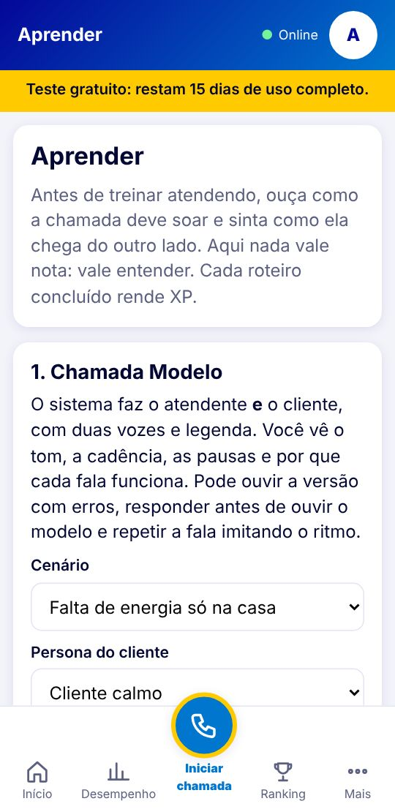

### 8.1 Chamada Modelo: o sistema faz os dois lados

O sistema fala o atendente e o cliente com vozes diferentes (se o aparelho tiver só uma voz, muda o tom) e mostra a legenda. Use os números 1 a 8 para escolher o passo.

- **Anotações**: embaixo das falas do atendente aparecem, em verde, o que ela faz bem (usar o nome, empatia, avisar o silêncio, falar o protocolo devagar, pedir licença...).
- **Cadência**: ao fim de cada passo aparecem as palavras por fala, a parte da conversa que é do cliente, o tempo de pausas e o número de perguntas. Os valores de referência são didáticos, não regras.
- **Ouvir a versão com erros**: a mesma chamada com falhas típicas (sem abertura, sem empatia, silêncio sem aviso, protocolo rápido demais, falas longas, sem "algo mais?"). As falhas aparecem em vermelho e as falas omitidas ficam riscadas.
- **Pare e responda**: a chamada pausa e pergunta o que você diria. Depois da sua resposta, o app mostra a fala-modelo, a porcentagem de ideias em comum e as palavras-chave que faltaram. Não há uma única resposta certa.
- **Repetir depois do modelo**: você repete a fala imitando o ritmo e o tom, grava e ouve as duas. A gravação fica só na tela e não é salva.
- **Só ler, sem som** e **velocidade** (0,75× a 1,5×) ajudam em lugares sem fones.

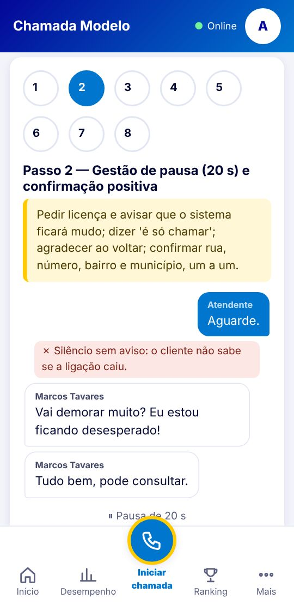

As pausas longas são aceleradas na tela (no máximo 8 s), mas o texto mostra o tempo real da chamada.

### 8.2 Troca de Lugar: você é o cliente

Você recebe o **cartão do cliente** (situação, jeito de falar e dados à mão) e responde ao atendente, que é o sistema. O **medidor de paciência** sobe com boas práticas e desce a cada falha, e a mensagem diz o que o cliente sentiu.

- Em cada vez do cliente, escolha entre o **jeito do personagem**, uma resposta **mais calma**, uma **mais impaciente** ou **as suas palavras** (digitando ou pelo microfone, quando o aparelho permitir). Quando o atendente pede uma verificação, toque em **Já verifiquei**.
- O atendente pode ser **bom ou com falhas**. No modo "às cegas" o app sorteia e você só descobre no fim. O medidor começa em, no mínimo, 60, para dar tempo de ver as falhas. Se a paciência chegar a zero, o cliente desliga, como um abandono real.
- Ao final você dá uma **nota de 0 a 10**, marca o que percebeu e, às cegas, diz se achou o atendimento bom. Depois o app mostra o que o atendente era, quantas falhas você percebeu e quais passaram despercebidas.
- A **reflexão** tem três perguntas opcionais e fica só neste aparelho (veja em "Minhas reflexões" na tela Aprender).

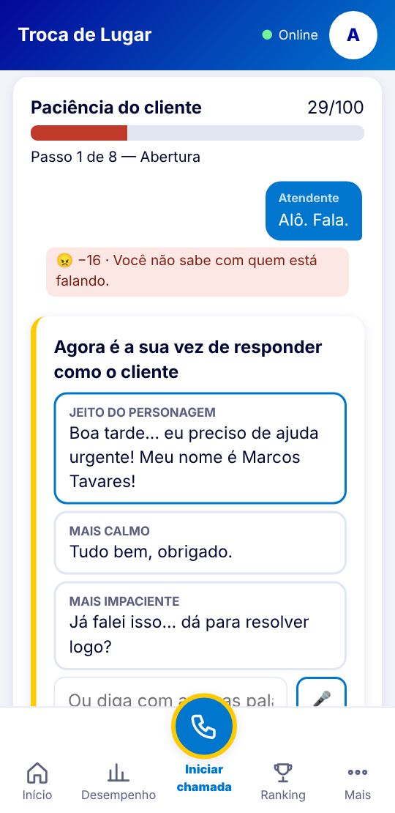

### 8.3 Duelo de alunos (em breve)

Um aluno atende e o outro é o cliente, cada um no seu aparelho, e depois trocam. Depende da nuvem do Fênix Core e fica para uma próxima versão.

## 9. Gravações

Em **Gravações** você ouve, exporta e apaga os áudios. O áudio fica somente no aparelho e nunca vai para a nuvem. Apagar exige digitar **APAGAR**.

## 10. Configurações

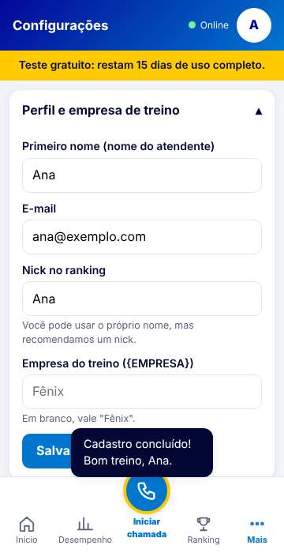

- **Perfil e empresa de treino**: nome, e-mail, nick e empresa do treino (com o aviso fixo).
- **Dados e armazenamento**: aparelho ou nuvem, com o aviso do risco de perda.
- **Preferências**: som de fundo, toque, animações, tema escuro e microfone automático.
- **Pontuação, metas e níveis**: pesos (somam 100), metas por passo (valem para roteiros próprios; os de fábrica trazem a própria meta) e limites de XP.
- **Perfil de uso (demonstração)**: aluno, supervisor ou administrador.
- **Backup**: exportar e importar um arquivo com o histórico, os roteiros e as configurações (sem áudios).
- **Excluir dados**: apagar gravações ou **excluir minha conta e meus dados** (exige digitar APAGAR).

## 11. Supervisor e administrador

O **supervisor** observa a sessão ao vivo sem intervir (passo atual, cronômetros e checklist), revisa simulações antigas e comenta. Enquanto observa, o aluno vê a faixa fixa **"Supervisor observando"**. O **administrador** gerencia membros e perfis, cenários oficiais e a campanha "Compartilhe e ganhe".

## 12. Sobre, ajuda e compartilhar

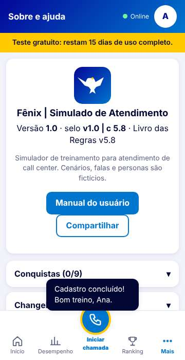

A tela **Sobre** traz a versão, o selo `v1.7 | c 5.8`, as conquistas, o Changelog (data de criação e de modificação), as políticas (Termos de Uso e Política de Privacidade oficiais, versão 4.9 de 27/10/2026, com os links reais) e o contato. O botão **Compartilhar** envia o app por WhatsApp ou e-mail.

## 13. Perguntas frequentes

- **O que mudou na v1.7?** A abertura (com os dois holofotes), o acesso (Entrar, Criar conta e Esqueceu a senha, com o farol de fundo) e os primeiros passos passaram a seguir os modelos oficiais Fênix 6.1. O login agora usa e-mail e senha, em linha com os Termos de Uso. A logo oficial em branco aparece nessas telas.
- **O que mudou na v1.6?** A logo oficial da Fênix (águia) passou a aparecer no menu, na abertura, no login, no onboarding, em Sobre e no cabeçalho de todos os PDFs. Os Termos de Uso e a Política de Privacidade agora abrem os textos oficiais (versão 4.9, de 27/10/2026). O pacote traz os PDFs avulsos em `roteiros-pdf-v1.6/`.
- **O que mudou na v1.5?** Nova persona 13, Cliente vital (home care), nos 10 cenários: agora são 130 roteiros. O pacote traz os 130 PDFs avulsos em `roteiros-pdf-v1.5/` e os roteiros de referência em `roteiros-referencia-v1.5/`.
- **O que mudou na v1.4?** Cada roteiro tem o botão "Baixar PDF", e o ícone oficial do Simulador de Atendimento entrou no app: abertura, cadastro, login, Sobre, aba do navegador e ícone de instalação. O pacote traz os 120 PDFs avulsos em `roteiros-pdf-v1.4/`.
- **Como instalo o app no celular?** Abra o endereço do app no navegador e use "Instalar app" ou "Adicionar à tela inicial". O ícone oficial aparece na tela inicial do aparelho.
- **O que mudou na v1.2?** A área Aprender, com a Chamada Modelo e a Troca de Lugar (seção 8).
- **O que mudou na v1.1?** Os 120 roteiros de fábrica entraram no app, com 2 cenários e 2 personas novos, diálogo completo no Treino guiado e metas de tempo corrigidas. Veja o Changelog na tela Sobre.

- **O app abre sem internet?** Sim. Ele tenta reconectar a cada cerca de 5 minutos. PDF e consulta de CNPJ precisam de internet.
- **O microfone não funciona.** Verifique a permissão do navegador ou digite a sua fala.
- **Perdi meus dados.** Se guardava só no aparelho, restaure o último backup em Configurações.
- **O teste acabou.** Sem licença, só dá para visualizar o histórico.

*Fênix Soluções Tecnológicas — WhatsApp (79) 9 9968-0880 — Instagram @fenixsolucoestecnologicas*
